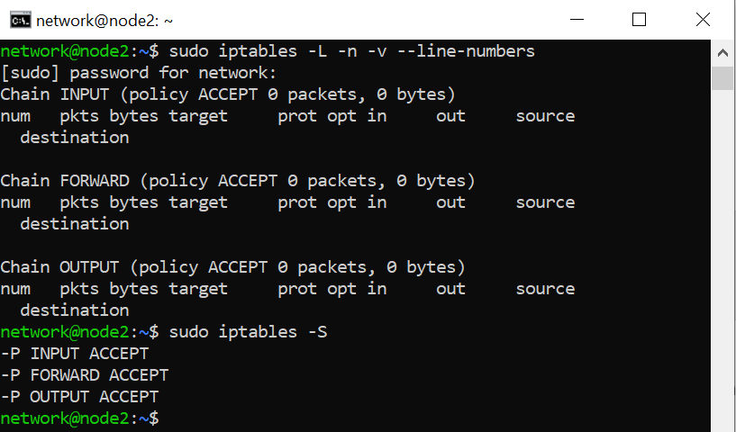
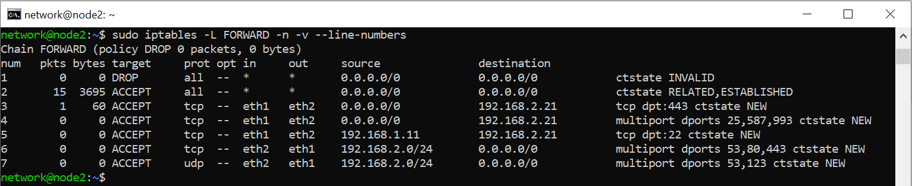

# Week 06 — Firewalls

**Task:** Verify and configure stateful iptables filtering on Virtnet `node2` (topology 5).

**Commands used:**
```bash
sudo iptables -L -n -v --line-numbers
sudo iptables -A FORWARD -m conntrack --ctstate ESTABLISHED,RELATED -j ACCEPT
sudo iptables -P FORWARD DROP
sudo iptables -L FORWARD -n -v --line-numbers
```

**Result:** Initial `INPUT`, `FORWARD` and `OUTPUT` policies were ACCEPT with no rules. Subsequently, seven forwarding rules permitted HTTPS (443), email (25/587/993), authorised SSH (22), and selected outbound traffic. Invalid traffic was dropped; the FORWARD default became DROP. Counters showed HTTPS and established traffic matched. Full rule set is visible in the screenshot.




