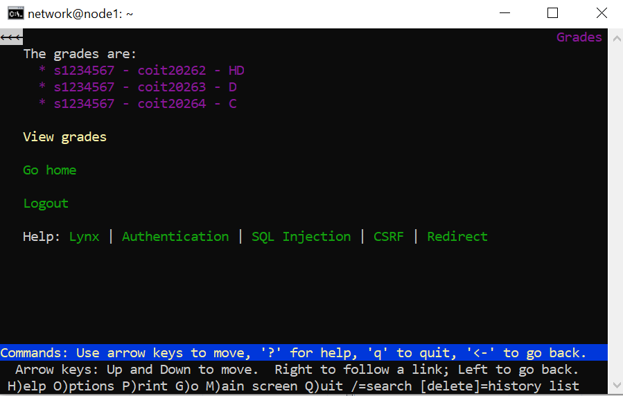

# Week 07 — Authentication

**Task/evidence available:** Inspect the MyUni grades application accessed through Lynx on `node1`.

**Relevant command:**
```bash
lynx https://www.12314045.edu/grades/
```

**Observation:** The saved screenshot shows a grades page and Logout option, consistent with an authenticated application session. The login and credential-verification steps were **not separately captured**. This image documents the displayed result, not the full Week 7 tutorial.



