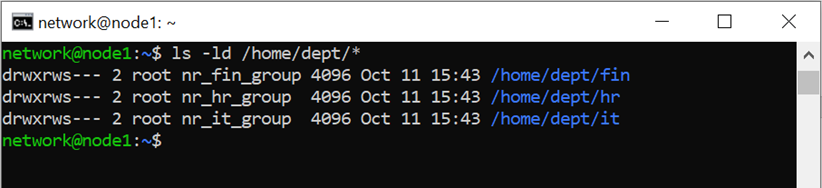
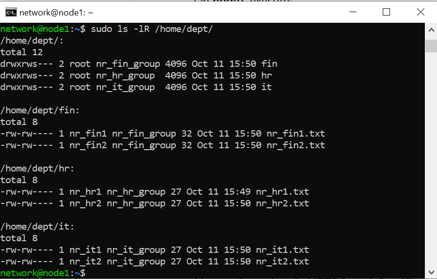
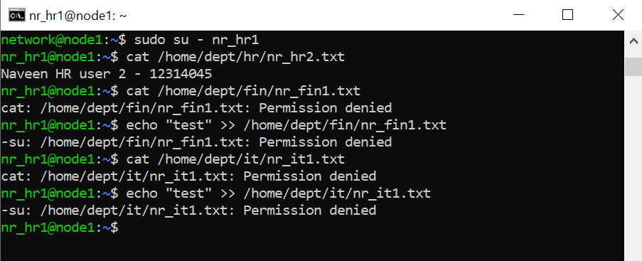
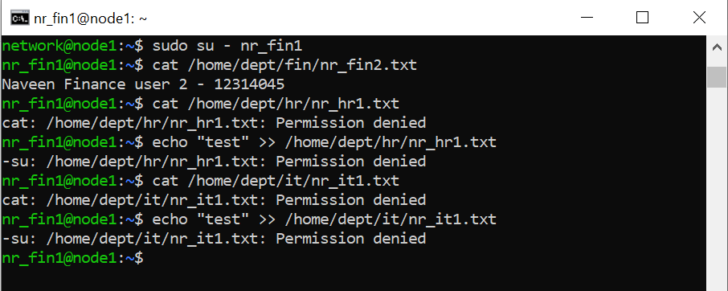
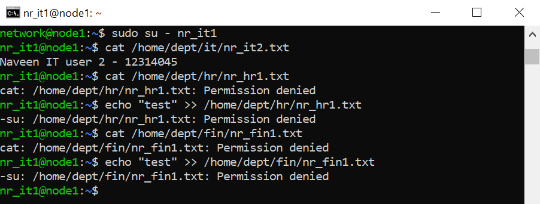

# Week 08 — Access Control

**Task:** Configure HR, Finance and IT access control on `node1`.

**Commands:**
```bash
ls -ld /home/dept/*
sudo ls -lR /home/dept/
sudo su - nr_hr1
cat /home/dept/fin/nr_fin1.txt
```

**Result:** Department directories had group ownership and `2770` (`drwxrws---`) permissions. Six user files had `-rw-rw----` permissions. HR, Finance and IT users could read same-department files; unauthorised cross-department reads and writes returned `Permission denied`.











