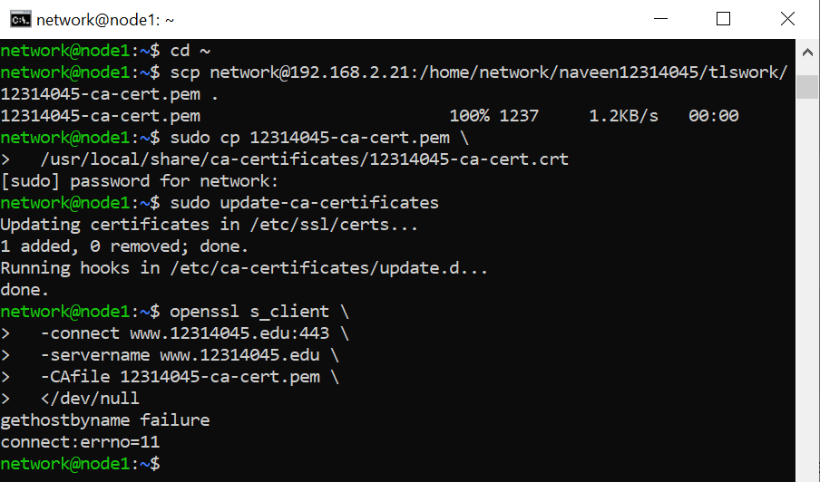
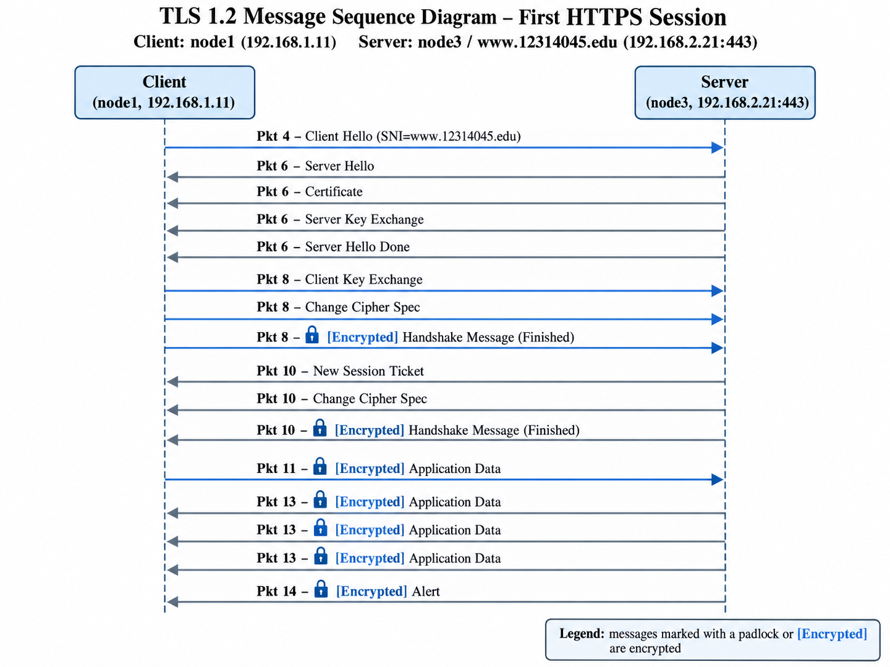

# Week 09 — Internet Security

**Task:** Configure CA-trusted HTTPS for `www.12314045.edu` and examine TLS 1.2 traffic.

**Commands recorded:**
```bash
scp network@192.168.2.21:/home/network/naveen12314045/tlswork/12314045-ca-cert.pem .
sudo update-ca-certificates
openssl s_client -connect www.12314045.edu:443 -servername www.12314045.edu -CAfile 12314045-ca-cert.pem </dev/null
```

**Result:** The CA was added successfully on node1 (`1 added`). The first OpenSSL test failed DNS resolution; hostname configuration needed correction. A later Wireshark listing shows TLS 1.2 handshakes for SNI `www.12314045.edu`, including Certificate, key exchange and encrypted application data. Six connections appeared in that listing; the first complete connection used client port 39000. The original `.pcap` must be retained separately.



[Wireshark packet listing](evidence/week09/03_wireshark_packet_listing.txt)


