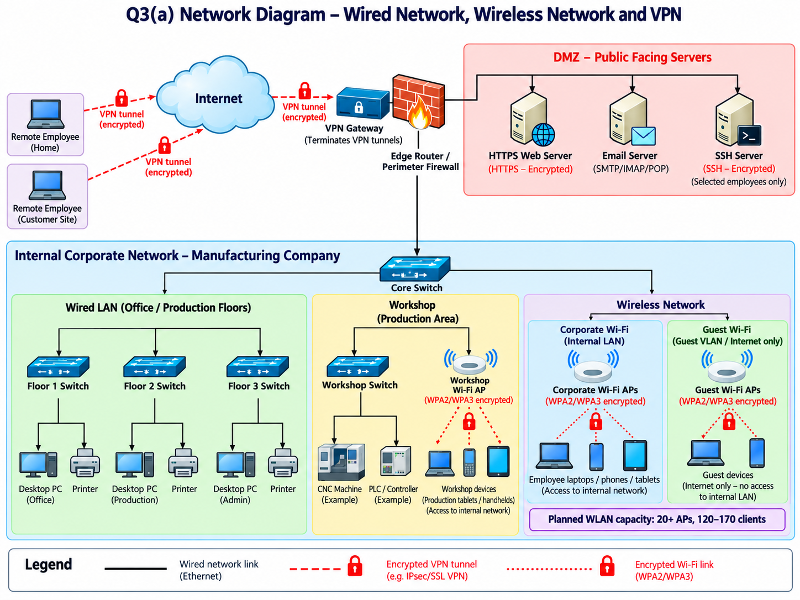

# Week 10 — Wireless Security

**Design exercise:** Plan corporate, guest and workshop Wi-Fi for the manufacturing company.

**Security choices:** Corporate and guest Wi-Fi are separate VLANs; guests receive Internet-only access. WPA2/WPA3 protects wireless client links. A workshop AP supports production handhelds. The plan states **20+ APs for 120–170 clients**. Remote staff use a VPN gateway and encrypted tunnels.

